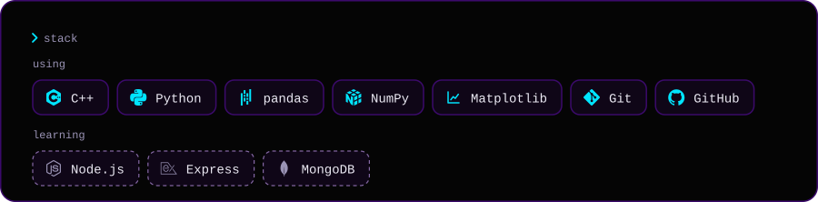
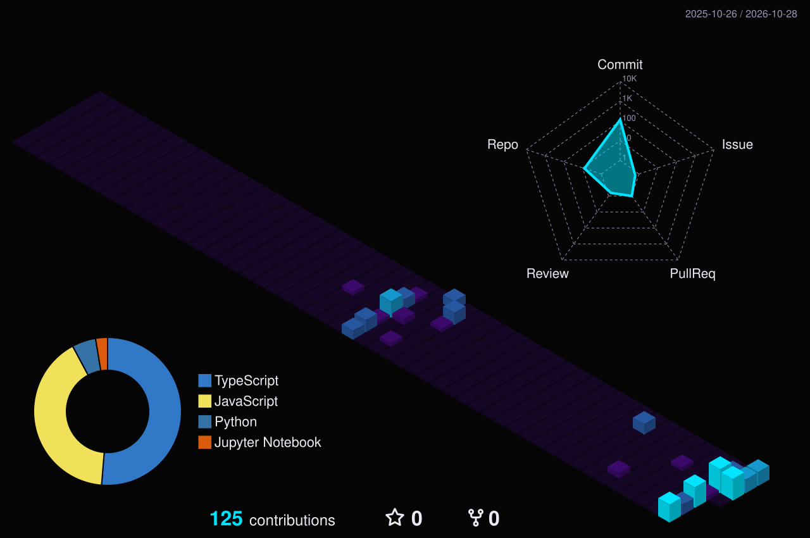

<!--
  Profile README for github.com/gargkapish.
  Don't hand-edit the SVGs in assets/: change data/profile.json and the workflow rebuilds them.
-->

  
  
  
  
  

- Second-year B.Tech CSE (Data Science) at Rishihood University, heading into **backend and DevOps**.
- Daily DSA. Every accepted LeetCode solution is archived automatically in [**DSA-Problems**](https://github.com/gargkapish/DSA-Problems).
- Building four projects through DevClub's **DoomsDay** program, Oct 2026 → Jan 2027.
- Open to **summer 2027 internships**, India or remote: [kapishgarg2006@gmail.com](mailto:kapishgarg2006@gmail.com)

 

<!-- building:start -->
<!-- building:end -->

 

 

 

 

 

 

<b>Beyond code</b>

 

- **General Secretary, Finanza** (2026–27): Rishihood University's finance & investment club. I run its digital presence, including the website.
- **Head of Outreach & Sponsorships, Datacron**: the university's data science fest. Corporate sponsorships, speaker pipeline, cross-campus attendees.

 

<picture>
  <source media="(prefers-color-scheme: dark)" srcset="./dist/snake-dark.svg" />
  <source media="(prefers-color-scheme: light)" srcset="./dist/snake-light.svg" />
  
</picture>
